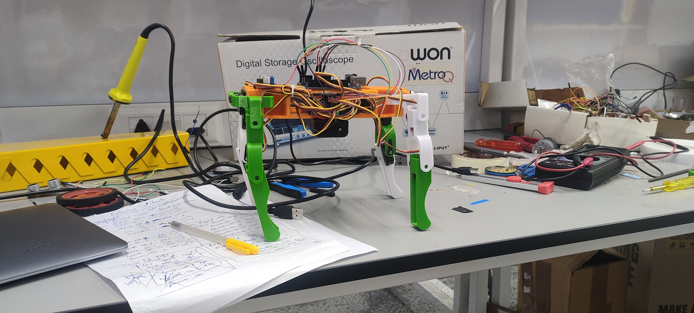
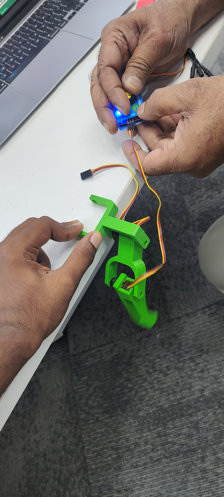
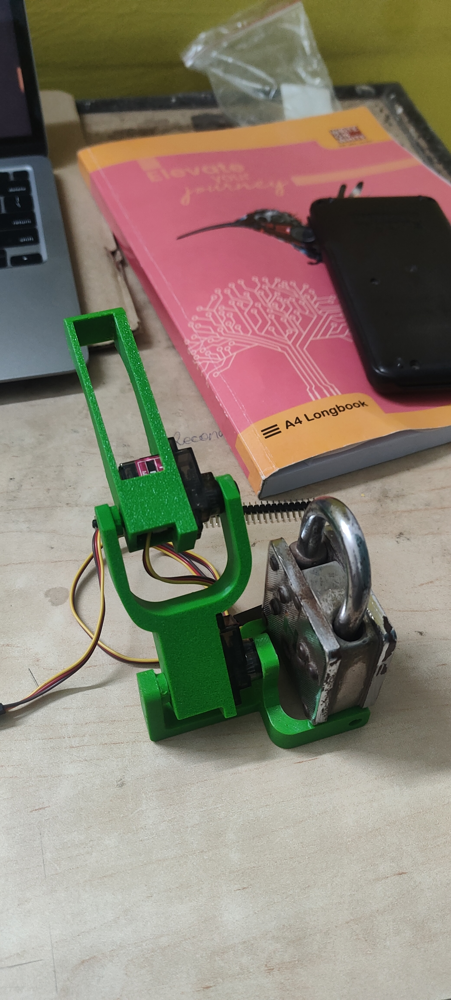
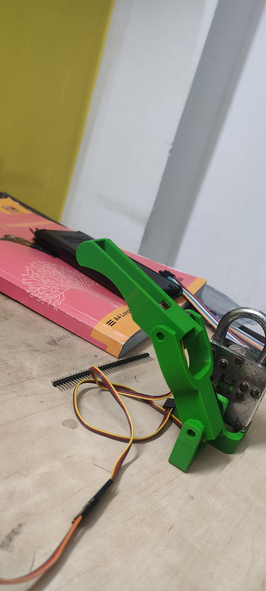
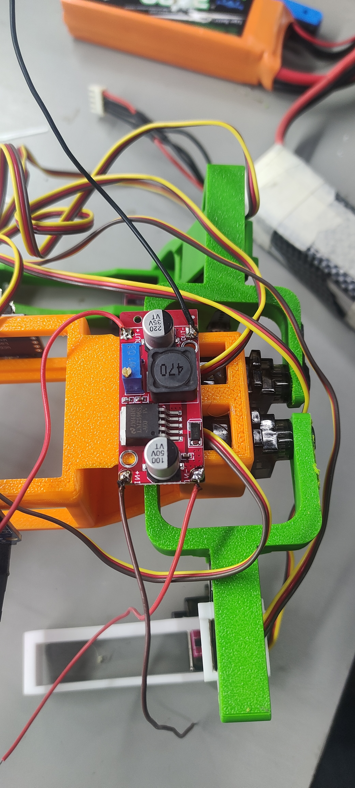
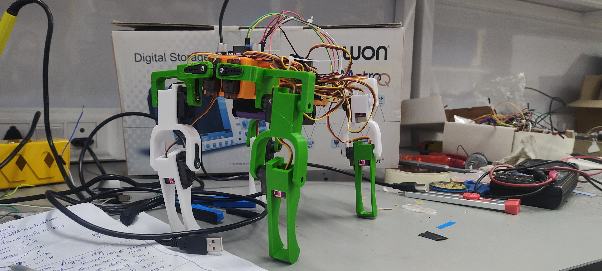
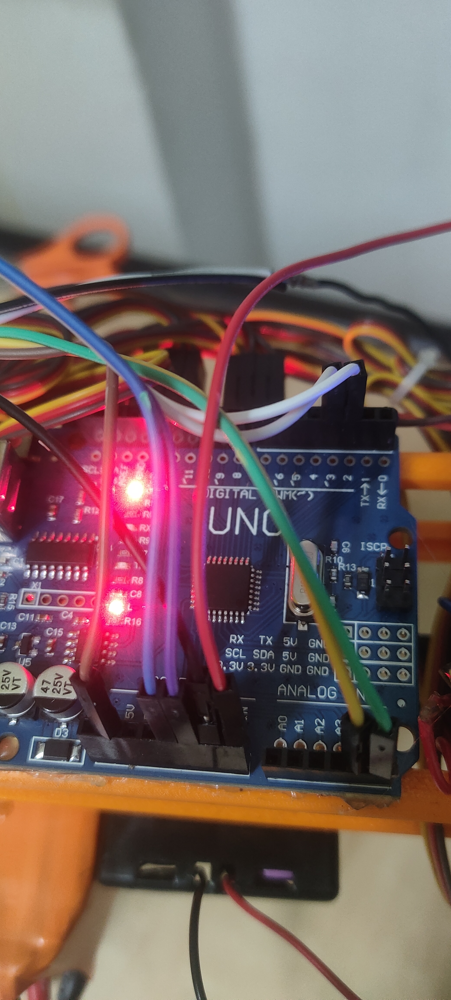

<div align="center">

# 🐕 RoboDog — Quadruped Walking Robot

### A 12-DOF Quadruped Robot Built from Scratch Using Standard Servo Motors, an Arduino Uno & Bluetooth

<br>



<br>

**Inverse Kinematics · Trot Gait · Bluetooth Control · Gesture Engine**

[](https://www.arduino.cc/)
[](https://isocpp.org/)
[](https://en.wikipedia.org/wiki/Bluetooth)
[](LICENSE)

</div>

---

## 📋 Table of Contents

- [Overview](#-overview)
- [The Challenge](#-the-challenge--why-this-project-stands-out)
- [Build Gallery](#-build-gallery)
- [Hardware & Components](#-hardware--components)
- [System Architecture](#-system-architecture)
- [Inverse Kinematics — The Math Behind the Walk](#-inverse-kinematics--the-math-behind-the-walk)
- [Gait & Motion System](#-gait--motion-system)
- [Gesture Engine](#-gesture-engine)
- [Bluetooth Command Protocol](#-bluetooth-command-protocol)
- [Circuit & Wiring](#-circuit--wiring)
- [Getting Started](#-getting-started)
- [Project Structure](#-project-structure)
- [Demo Videos](#-demo-videos)
- [Challenges & Lessons Learned](#-challenges--lessons-learned)
- [Future Roadmap](#-future-roadmap)

---

## 🚀 Overview

**RoboDog** is a fully functional 12-DOF (Degrees of Freedom) quadruped walking robot that I designed and built entirely from scratch. The robot walks, turns, sits, does pushups, and even shakes hands — all controlled wirelessly via Bluetooth from a smartphone.

What makes this project unique is that it was built using **only standard hobby servo motors** (SG90/MG90S), an **Arduino Uno**, and an **HC-05 Bluetooth module** — no expensive dynamixel servos, no Raspberry Pi, no fancy motor drivers. Just fundamental engineering, 3D-printed parts, and hand-written inverse kinematics.

> **This project demonstrates my ability to take a complex robotics problem — from kinematic modeling to real-time embedded control — and solve it end-to-end with minimal, budget-friendly hardware.**

---

## 💡 The Challenge — Why This Project Stands Out

Most quadruped robots you'll find online rely on high-torque serial bus servos (like Dynamixel), powerful SBCs (like Raspberry Pi or Jetson), and pre-built frameworks (like ROS). I wanted to prove that a walking quadruped robot can be built with **the most basic components available**:

| Constraint | My Solution |
|:---|:---|
| **No Dynamixel servos** — only basic PWM servos | Wrote custom inverse kinematics to compute precise joint angles, then mapped them to calibrated PCA9685 PWM pulse values for each individual servo |
| **No Raspberry Pi / computer onboard** | Ran the entire IK engine, gait sequencer, and Bluetooth parser on a single **8-bit ATmega328P** (Arduino Uno) with only **2 KB of RAM** |
| **No ROS / pre-built framework** | Designed the trot gait algorithm from scratch, implementing diagonal leg coordination with smooth interpolation |
| **No expensive motor drivers** | Used a **PCA9685** 16-channel I²C PWM driver to control all 12 servos simultaneously from the Arduino |
| **Budget under ₹3,000 (~$35)** | Carefully selected commodity components and 3D-printed all structural parts |

---

## 📸 Build Gallery

<div align="center">

| Stage | Photo | Description |
|:---:|:---:|:---|
| **Leg Assembly** |  | Assembling individual leg joints with SG90 servo motors and 3D-printed brackets |
| **Joint Mechanism** |  | Close-up of the 3-DOF leg mechanism — hip, femur, and tibia joints |
| **Leg Side View** |  | Side profile showing the leg linkage geometry |
| **Electronics Bay** |  | LM2596 buck converter, PCA9685 servo driver, and wiring harness mounted on the chassis |
| **Full Robot** |  | Completed RoboDog standing — front view with all 4 legs assembled |
| **Perspective View** |  | Three-quarter view showcasing the 3D-printed frame and servo layout |
| **Arduino Brain** |  | The Arduino Uno with HC-05 Bluetooth module and I²C connection to PCA9685 |

</div>

---

## 🔩 Hardware & Components

| Component | Specification | Quantity | Purpose |
|:---|:---|:---:|:---|
| **Arduino Uno** | ATmega328P, 16 MHz, 2 KB RAM | 1 | Main controller — runs IK, gait engine, and Bluetooth parsing |
| **PCA9685** | 16-channel, 12-bit PWM, I²C | 1 | Servo driver — simultaneous control of all 12 servos |
| **SG90 / MG90S Servos** | 180° standard PWM servos | 12 | Joint actuators — 3 per leg (hip, femur, tibia) |
| **HC-05 Bluetooth Module** | Bluetooth 2.0, Serial SPP | 1 | Wireless command receiver via smartphone |
| **LM2596 Buck Converter** | Adjustable DC-DC step-down | 1 | Regulates LiPo voltage to stable 5V for servos |
| **7.4V LiPo Battery** | 2S, 1000–1500 mAh | 1 | Power source |
| **3D-Printed Frame** | PLA, custom designed | — | Structural chassis, leg brackets, and body shell |
| **Jumper Wires & Connectors** | Male-Male, Male-Female | — | Wiring harness |

---

## 🧠 System Architecture

```
┌──────────────────────────────────────────────────────────┐
│                    SMARTPHONE APP                        │
│              (Bluetooth Serial Terminal)                  │
│         Sends: F / B / L / R / W / S / P                │
└──────────────────────┬───────────────────────────────────┘
                       │ Bluetooth (HC-05)
                       ▼
┌──────────────────────────────────────────────────────────┐
│                   ARDUINO UNO                            │
│  ┌─────────────┐  ┌──────────────┐  ┌────────────────┐  │
│  │  Bluetooth   │  │   Inverse    │  │   Gait         │  │
│  │  Command     │→ │  Kinematics  │→ │  Sequencer &   │  │
│  │  Parser      │  │  Engine      │  │  Interpolator  │  │
│  └─────────────┘  └──────────────┘  └───────┬────────┘  │
│                                              │           │
│                                     I²C Bus  │           │
└──────────────────────────────────────┬───────┘───────────┘
                                       ▼
┌──────────────────────────────────────────────────────────┐
│                  PCA9685 PWM DRIVER                       │
│                                                          │
│  CH0-CH2: Left Front Leg    CH3-CH5: Right Front Leg     │
│  CH6-CH8: Left Back Leg    CH9-CH11: Right Back Leg      │
│                                                          │
│   Each leg: [Hip Servo] [Femur Servo] [Tibia Servo]      │
└──────────────────────────────────────────────────────────┘
```

---

## 📐 Inverse Kinematics — The Math Behind the Walk

Each leg has **3 degrees of freedom** (hip, femur, tibia), and the IK engine computes the required joint angles to place each foot at a desired `(x, y, z)` coordinate in 3D space.

### Leg Geometry

```
Link Lengths (cm):
  L1 = 1.5   (hip vertical offset)
  L2 = 5.7   (femur length)
  L3 = 5.5   (tibia length)
  L4 = 5.0   (hip horizontal offset)
```

### IK Equations

Given a target foot position `(footX, footY, footZ)`:

**1. Hip Angle (θ₁):**
```
θ₁ = atan2(footY, footX) + acos(L4 / √(footX² + footY²))
```

**2. Knee Angle (θ₃) — via law of cosines:**
```
A = √(footX² + footY² − L4²)
k = (L2² + L3² − (L1 − A)² − footZ²) / (2 · L2 · L3)
θ₃ = acos(clamp(k, −1, 1))
```

**3. Femur Angle (θ₂):**
```
t = (L2² + (L1 − A)² + footZ² − L3²) / (2 · L2 · √((L1 − A)² + footZ²))
θ₂ = atan2(L1 − A, footZ) − acos(clamp(t, −1, 1))
```

Each computed angle is then mapped to **calibrated PCA9685 pulse values** unique to each servo (compensating for manufacturing variance and mounting offsets).

---

## 🦿 Gait & Motion System

### Trot Gait (Diagonal Pair Locomotion)

The robot uses a **trot gait** — the most stable two-phase gait for quadrupeds. Diagonal legs move together:

```
Phase 1: Left-Front + Right-Back SWING    |  Right-Front + Left-Back STANCE
Phase 2: Right-Front + Left-Back SWING    |  Left-Front + Right-Back STANCE
```

### Smooth Motion via Interpolation

All leg movements use a custom **linear interpolation engine** that:
1. Calculates the increment per step for each axis `(x, y, z)` across all 4 legs
2. Updates all 12 servo positions simultaneously at each step
3. Applies a 10ms delay per step for smooth, jitter-free motion

```cpp
// Interpolation: Smoothly transition all 4 legs from OldPos to NewPos
for (int i = 0; i < steps; i++) {
    for (int leg = 0; leg < 4; leg++) {
        computeIK(currentPos[leg], servo1, servo2, servo3, leg + 1);
        pwm.setPWM(3*leg,   0, servo1);  // Hip
        pwm.setPWM(3*leg+1, 0, servo2);  // Femur
        pwm.setPWM(3*leg+2, 0, servo3);  // Tibia
    }
    delay(10);
}
```

### Supported Movements

| Command | Action | Technique |
|:---:|:---|:---|
| `F` | Walk Forward | Trot gait with forward Z-axis displacement |
| `B` | Walk Backward | Trot gait with reversed Z-axis displacement |
| `R` | Turn Right | Differential trot — right legs move slower than left |
| `L` | Turn Left | Differential trot — left legs move slower than right |

---

## 🎭 Gesture Engine

Beyond walking, the robot has expressive gestures that demonstrate fine motor control:

### 🤝 Handshake (`W`)
1. Shifts weight to three supporting legs
2. Smoothly lifts the right-front leg using direct hardware PWM interpolation
3. Performs a 3-cycle wave animation
4. Gracefully lowers the leg and returns to standing

### 🪑 Sit (`S`)
1. Keeps front legs locked in standing position
2. Slowly crouches the back legs (Y: −11 → −4, Z: −1 → 1)
3. Holds the pose for 2 seconds, then smoothly returns

### 💪 Pushups (`P`)
1. All four legs bend simultaneously to a low position (Y: −11 → −5)
2. Repeats 3 full push-up cycles
3. Returns to standing posture

---

## 📡 Bluetooth Command Protocol

The robot accepts single-character commands over Bluetooth serial at **9600 baud**:

```
┌──────────┬───────────────┬─────────────────────────────┐
│ Command  │    Action     │      Description            │
├──────────┼───────────────┼─────────────────────────────┤
│    F     │  Forward      │  Trot walk forward          │
│    B     │  Backward     │  Trot walk backward         │
│    R     │  Turn Right   │  Curved trot to the right   │
│    L     │  Turn Left    │  Curved trot to the left    │
│    W     │  Wave/Shake   │  Handshake gesture          │
│    S     │  Sit          │  Sit down posture           │
│    P     │  Pushups      │  Push-up exercise           │
└──────────┴───────────────┴─────────────────────────────┘
```

**Compatible Apps:** Any Bluetooth Serial Terminal app (e.g., "Serial Bluetooth Terminal" on Android).

---

## ⚡ Circuit & Wiring

```
                         ┌─────────────────┐
  7.4V LiPo ──────────→ │  LM2596 Buck    │──→ 5V Rail
                         │  Converter      │
                         └────────┬────────┘
                                  │
              ┌───────────────────┼───────────────────┐
              │                   │                   │
              ▼                   ▼                   ▼
     ┌────────────────┐  ┌───────────────┐   ┌──────────────┐
     │  Arduino Uno   │  │   PCA9685     │   │   HC-05      │
     │                │  │   PWM Driver  │   │   Bluetooth  │
     │  SDA (A4) ─────│──│→ SDA          │   │              │
     │  SCL (A5) ─────│──│→ SCL          │   │  RX ← Pin 2 │
     │  Pin 2 (TX) ───│──│               │───│→ TX → Pin 3  │
     │  Pin 3 (RX) ───│──│               │   │              │
     │  5V ───────────│──│→ VCC          │   │  VCC → 5V    │
     │  GND ──────────│──│→ GND          │   │  GND → GND   │
     └────────────────┘  │               │   └──────────────┘
                         │  CH0-CH2: LF  │
                         │  CH3-CH5: RF  │
                         │  CH6-CH8: LB  │
                         │  CH9-CH11: RB │
                         │               │
                         │  V+ ← 5V Rail │
                         └───────────────┘
```

---

## 🛠 Getting Started

### Prerequisites
- [Arduino IDE](https://www.arduino.cc/en/software) (1.8+ or 2.x)
- Required Libraries:
  - `Adafruit PWM Servo Driver Library` (for PCA9685)
  - `SoftwareSerial` (built-in)

### Upload & Run

```bash
# 1. Clone this repository
git clone https://github.com/WithSamir/RoboDog.git
cd RoboDog

# 2. Open in Arduino IDE
#    File → Open → src/RoboDog.cpp
#    (Rename to .ino if the IDE requires it)

# 3. Install libraries
#    Sketch → Include Library → Manage Libraries
#    Search and install: "Adafruit PWM Servo Driver Library"

# 4. Select board & port
#    Tools → Board → Arduino Uno
#    Tools → Port → (your COM port)

# 5. Upload!
```

### Bluetooth Control
1. Pair your phone with the HC-05 module (default PIN: `1234`)
2. Open any Bluetooth Serial Terminal app
3. Connect to HC-05
4. Send commands: `F`, `B`, `L`, `R`, `W`, `S`, `P`

---

## 📁 Project Structure

```
RoboDog/
├── README.md                          # This file
├── src/
│   └── RoboDog.cpp                    # Main source code (IK, gait, gestures, BT)
├── media/
│   ├── images/
│   │   ├── 01_leg_assembly_servo_wiring.jpg
│   │   ├── 02_leg_joint_mechanism.jpg
│   │   ├── 03_leg_closeup_side_view.jpg
│   │   ├── 04_body_electronics_buck_converter.jpg
│   │   ├── 05_full_robot_front_view.jpg
│   │   ├── 06_full_robot_perspective_view.jpg
│   │   └── 07_arduino_uno_wiring_detail.jpg
│   └── videos/
│       ├── 01_first_leg_test.mp4
│       ├── 02_servo_calibration.mp4
│       ├── 03_walking_test.mp4
│       ├── 04_full_demo.mp4
│       └── 05_bluetooth_control_demo.mp4
├── IMG20260718160448.jpg              # Original build photos
├── IMG20260719222619.jpg
├── IMG20260719222626.jpg
├── IMG20260721125316.jpg
├── IMG20260722122438.jpg
├── IMG20260722122447.jpg
├── IMG20260801233805.jpg
├── VID20260718160427.mp4              # Original video recordings
├── VID20260718160443.mp4
├── VID20260719232858.mp4
├── VID20260722222720.mp4
└── WhatsApp Video 2026-10-28 at 00.31.25.mp4
```

---

## 🎬 Demo Videos

> 📹 Video demos are available in the [`media/videos/`](media/videos/) directory:

| Video | Description |
|:---|:---|
| `01_first_leg_test.mp4` | First successful single-leg IK test |
| `02_servo_calibration.mp4` | Calibrating servo pulse ranges |
| `03_walking_test.mp4` | Early trot gait walking test |
| `04_full_demo.mp4` | Full demonstration — walking, turning, gestures |
| `05_bluetooth_control_demo.mp4` | Live Bluetooth control from phone |

---

## 🧗 Challenges & Lessons Learned

1. **Servo Calibration Nightmare** — Each servo has slightly different pulse-to-angle mapping. I had to individually calibrate all 12 servos and create a unique mapping table (the `#define` block at the top of the code).

2. **2 KB RAM Constraint** — The Arduino Uno has only 2 KB of SRAM. I had to be extremely careful with memory — using stack-allocated arrays instead of heap, avoiding `String` objects, and keeping the interpolation buffer minimal.

3. **Power Distribution** — 12 servos drawing current simultaneously caused brownouts. Solved by adding a dedicated LM2596 buck converter and separating the servo power rail from the logic power rail.

4. **IK Singularities** — When foot positions approach the workspace boundary, the inverse kinematics can produce `NaN` values. I added `constrain()` clamping to prevent servo jitter at edge cases.

5. **Gait Stability** — Getting the trot timing right so the robot doesn't fall over required extensive trial and error with the lift height, step length, and interpolation speed parameters.

---

## 🗺 Future Roadmap

- [ ] **IMU Integration** — Add an MPU6050 for self-balancing and terrain adaptation
- [ ] **Obstacle Avoidance** — Ultrasonic/LIDAR sensors for autonomous navigation
- [ ] **Custom Android App** — Joystick-based control with real-time telemetry
- [ ] **ESP32 Upgrade** — WiFi control with OTA firmware updates
- [ ] **Creep Gait** — Implement a slower, more stable 3-leg-grounded gait
- [ ] **ROS2 Integration** — Migrate to a ROS2-based architecture for advanced autonomy

---

<div align="center">

### Built with ❤️, solder, and a lot of servo calibration.

**Samir Ali** · [GitHub](https://github.com/WithSamir)

*If you found this project interesting, consider giving it a ⭐!*

</div>
